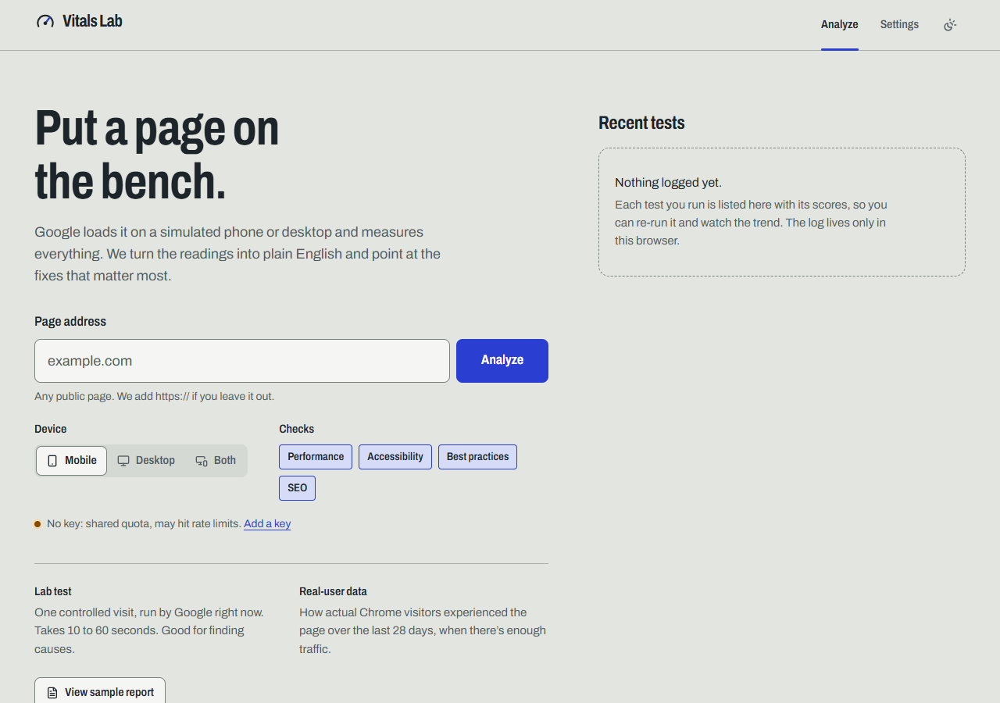
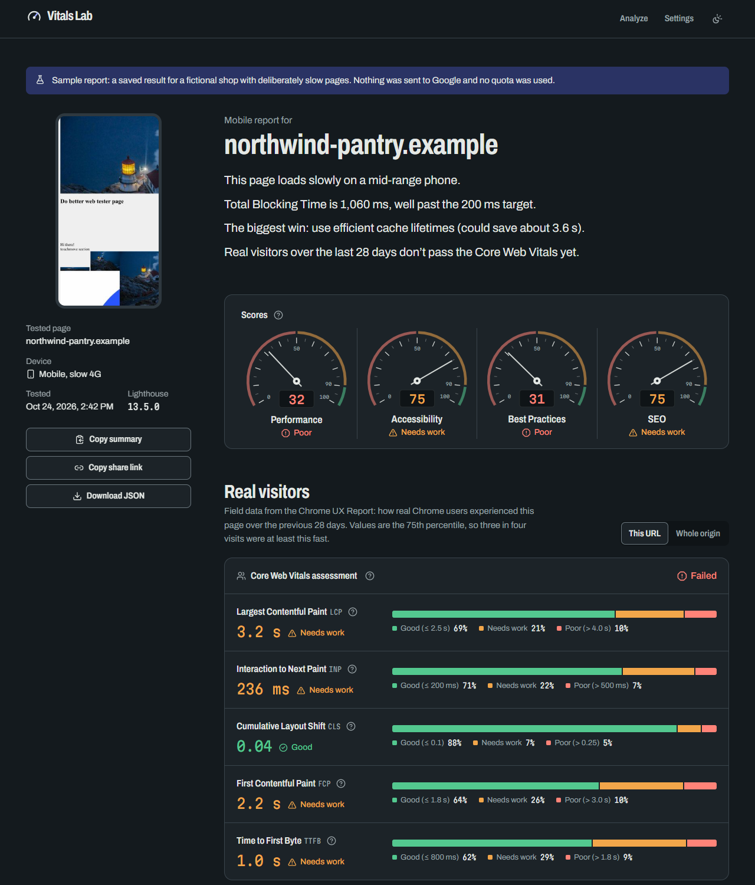
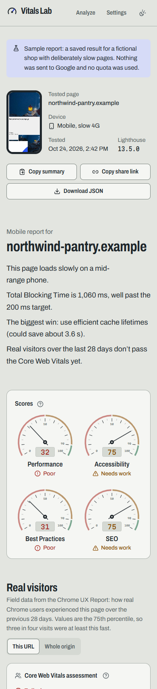
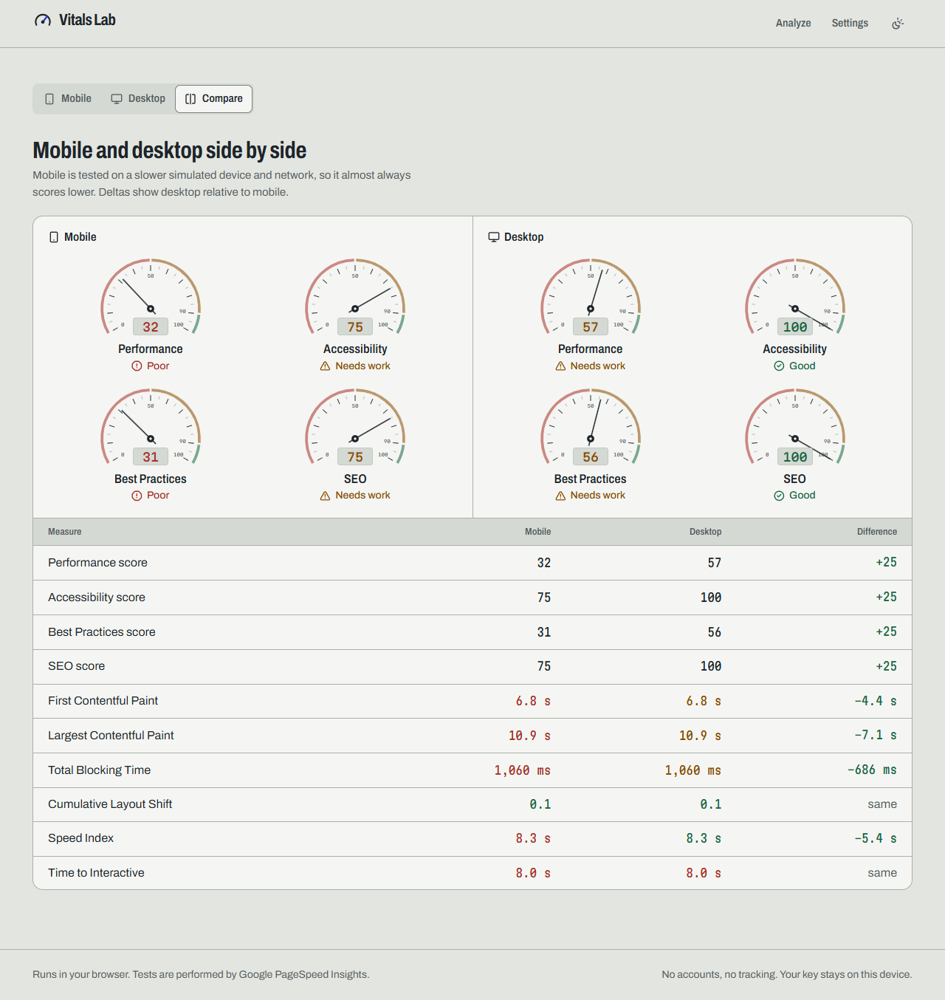
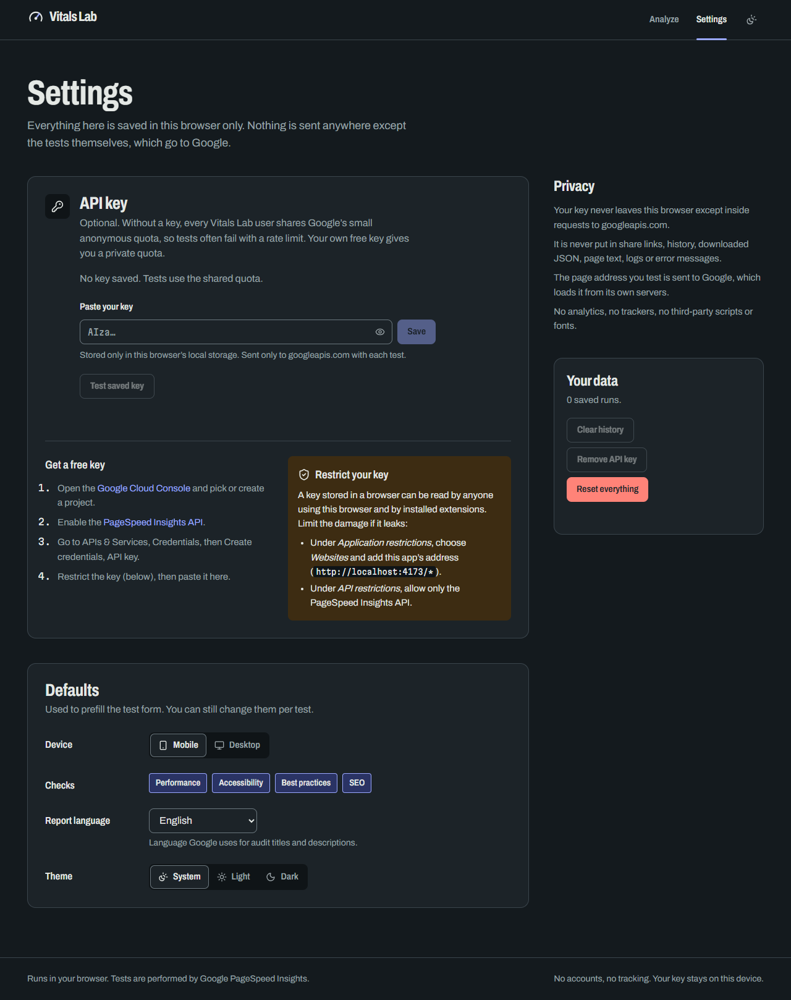

# Vitals Lab

A frontend-only dashboard for the [Google PageSpeed Insights API v5](https://developers.google.com/speed/docs/insights/v5/get-started). Enter a public URL, pick mobile, desktop or both, and get the Lighthouse lab test and Chrome UX Report field data in plain English, rendered in our own UI.

- No backend, no accounts, no analytics. Deploys as static files.
- Works without an API key (shared quota, may rate-limit) or with your own key, stored only in your browser.
- A bundled sample report lets you explore everything offline without spending quota.

| Home                                                  | Report (dark)                                                  |
| ----------------------------------------------------- | -------------------------------------------------------------- |
|  |  |

| Mobile report                                          | Mobile vs desktop                             | Settings                                                    |
| ------------------------------------------------------ | --------------------------------------------- | ----------------------------------------------------------- |
|  |  |  |

## Quick start

Requires Node 20.19+ (developed on Node 24) and npm.

```bash
npm i
npm run dev        # http://localhost:5173
```

Click **View sample report** to see a full report with no network access.

## Scripts

| Script                            | What it does                                         |
| --------------------------------- | ---------------------------------------------------- |
| `npm run dev`                     | Vite dev server                                      |
| `npm run build`                   | Typecheck (`tsc -b`) and production build to `dist/` |
| `npm run preview`                 | Serve the production build locally                   |
| `npm run typecheck`               | TypeScript strict check                              |
| `npm run lint`                    | ESLint, fails on any warning                         |
| `npm run test`                    | Vitest unit and component tests                      |
| `npm run test:watch`              | Vitest in watch mode                                 |
| `npm run format` / `format:check` | Prettier                                             |

## Getting and restricting a PSI API key

Without a key, every user of the app shares Google’s small anonymous quota, and tests often fail with HTTP 429. A key is free.

1. Open the [Google Cloud Console](https://console.cloud.google.com/) and create or pick a project.
2. Enable the [PageSpeed Insights API](https://console.cloud.google.com/apis/library/pagespeedonline.googleapis.com).
3. Go to **APIs & Services → Credentials → Create credentials → API key**.
4. **Restrict the key** (strongly recommended):
   - _Application restrictions_: **Websites**, and add your deployment, e.g. `https://vitals.example.com/*`.
   - _API restrictions_: allow only the **PageSpeed Insights API**.
5. Paste it in **Settings → API key**, then press **Test saved key**.

A key kept in a browser can be read by anyone using that browser and by installed extensions. The restrictions above limit what a leaked key can do.

## Privacy and security

- The API key lives only in `localStorage` (`vitalslab:v1:apiKey`). It is read at request time and sent only as the `key` query parameter to `https://www.googleapis.com`.
- It never appears in share links, history, downloaded JSON, page text, console output or error messages. Error text from Google is passed through a redactor (`redactKey` in `src/lib/psi-client.ts`) that strips `key=` values and anything shaped like a Google API key. Tests cover this.
- History stores compact summaries only (URL, device, time, four scores, six metrics), capped at 30. The latest full result is kept in `sessionStorage` so a refresh doesn’t lose it.
- Production builds ship a Content-Security-Policy meta tag: scripts and fonts from the app’s own origin only (plus one hashed inline theme script), images from self and `data:` (API screenshots), and `connect-src` limited to `https://www.googleapis.com`. No third-party scripts, trackers or font CDNs.
- Audit descriptions are rendered with a tiny safe renderer that understands only `[text](url)` and `` `code` ``. No `dangerouslySetInnerHTML`. External links open with `rel="noopener noreferrer"`.
- Storage access is wrapped in try/catch with an in-memory fallback, so private mode or blocked storage doesn’t crash the app (a banner explains settings won’t persist).

## Project structure

```
build/
  html-plugin.ts        Vite plugin: inline theme script, CSP (build only), font preload
  theme-init.js         Applies the saved theme before first paint
docs/
  DESIGN.md             Design direction, tokens and rules every screen follows
  screenshots/
scripts/
  make-fixture.mjs      Regenerates the sample report fixture
src/
  app/                  App, router (HashRouter), layout, settings context
  components/
    ui/                 shadcn/ui components, restyled to our tokens
    gauge/              Dial (category score) and StripGauge (metric scale)
    history/            Logbook (recent tests) and Sparkline
    shared/             Rating marks, info popovers, confirm dialog, wordmark
  features/
    analyze/            Form, run store (useReducer + AbortController), loading and error views
    home/               Home page
    report/             Report page and every section (field, lab, filmstrip, audits, compare)
    settings/           Settings page and API key panel
  fixtures/sample-report.json
  lib/
    psi-client.ts       Query builder, fetch with timeout/cancel, error mapping, key redaction, parsing
    psi-schemas.ts      zod (mini) schemas for the parts of the response we read
    psi-types.ts        Constants and types (no runtime deps)
    ratings.ts          Thresholds and rating helpers
    crux.ts             Field data (CrUX) parsing
    report-model.ts     Lab metrics, opportunities, grouping, plain-language summary
    storage.ts          Typed, versioned localStorage/sessionStorage layer with migrations
    history.ts          History entries and per-URL trends
    format.ts           ms / bytes / CLS / time formatters
    markdown-lite.tsx   Safe description renderer
    url.ts              URL normalisation and public-host validation
  styles/               tokens.css (light and dark palettes), globals.css
```

## Deployment

`npm run build` produces a static `dist/` folder with relative asset paths. The app uses `HashRouter`, so every route lives after `#` and **no rewrite rules are needed** on any host.

- **Vercel**: import the repo, framework preset _Vite_, build command `npm run build`, output directory `dist`.
- **Netlify**: build command `npm run build`, publish directory `dist`.
- **GitHub Pages**: build, then publish `dist/` (for example with `actions/upload-pages-artifact` and `actions/deploy-pages`). Works under a project sub-path such as `/vitals-lab/` because asset paths are relative.
- **Any static host or bucket**: upload `dist/`.

After deploying, add the site’s URL to your API key’s _Website_ restrictions.

## Decisions and assumptions

**Product**

- Kept the working name _Vitals Lab_: short and descriptive; nothing better earned the change.
- Opening a share link (`#/report?url=…&strategy=…`) runs the test automatically, unless this tab already holds that exact result (so refreshing a report never spends quota). `strategy` accepts `mobile`, `desktop` or `both`.
- **Analyze both** runs the two strategies in parallel. If one fails and the other succeeds, the report shows the success with an inline error for the other.
- The opportunities list follows the brief (`score < 0.9`, not `notApplicable`/`informative`) and also skips `manual` and `error` audits and the `metrics`/`hidden` groups, which are not actionable.
- Lighthouse 13 no longer sends `auditRefs[].relevantAudits`, so the metric filter falls back to each audit’s `metricSavings` keys. Both sources are merged when present.
- Core Web Vitals pass when LCP, CLS and (if present) INP are all good at p75. Without LCP or CLS the assessment says there isn’t enough data.
- History keeps one entry per strategy per run. The sixth stored metric is field INP (p75) when available, since lab TTI is deprecated.
- The **Test key** button runs a real, small request (example.com, desktop, SEO only, about 10 seconds). A Lighthouse site error still counts as a valid key, because Google accepted it.
- Loading stages are time-based and labelled as indicative; there is no fake percentage. Requests time out at 90 seconds.

**Design** (details in [docs/DESIGN.md](docs/DESIGN.md))

- Replaced the suggested “warm paper editorial” look with a _bench instrument_ direction. The paper/serif/hairline combination has become a common generated look; panel meters and calibrated scales are closer to the subject and give the gauges a natural home. All functional asks from the brief are kept (one accent separate from rating colors, mono numerals, instrument gauges, asymmetric layout, a real dark mode).
- Fonts: Archivo (variable width, used condensed for headings) and Martian Mono for numbers, self-hosted via Fontsource.
- Info popovers instead of hover tooltips for jargon, because they work on touch and with the keyboard.

**Engineering**

- **No TanStack Query.** A single in-flight run with cancellation fits a small `useReducer` store with `AbortController`; it saves bundle size. The brief allowed either.
- **zod/mini**, loaded on demand together with the PSI client, so schema validation stays out of the first-load bundle. `storage.ts` uses small hand-written validators for the same reason.
- **TypeScript 6.0** is pinned: typescript-eslint does not yet support TypeScript 7. **React Router 7** (`react-router` package) is used rather than the brand-new v8.
- The Content-Security-Policy is injected at build time only, because Vite’s dev server needs an inline HMR preamble.
- The sample fixture is built from Lighthouse’s own `sample_v2.json` (Lighthouse 13.5, Apache-2.0), with the test-server URLs replaced by the fictional `northwind-pantry.example` and illustrative CrUX field data added. Regenerate it with `node scripts/make-fixture.mjs <path-to-sample_v2.json>`.

**Verification notes**

- Field names were verified against real Lighthouse 13.5 output (the fixture source). During development the anonymous PSI quota was exhausted, so the live **no-key 429 path** was tested end to end against Google, and the success path (mobile, desktop, both, compare, history, re-run) was tested with the fixture served through an intercepted network request. **Run one live test with your own key** to confirm the success path against the live API.
- Lighthouse on the production build (`npm run preview`, headless Chrome): home page 91–98 performance on mobile and 100 on desktop; accessibility 100 in both light and dark themes; best practices 100. The sample report page scores 70–84 on mobile because it loads the 74 KB (gzipped) fixture with screenshots.
- SEO reports 91 only because the strict `connect-src` blocks Lighthouse’s in-page `robots.txt` fetch. `robots.txt` itself is served correctly; the CSP is kept as the brief requires.
